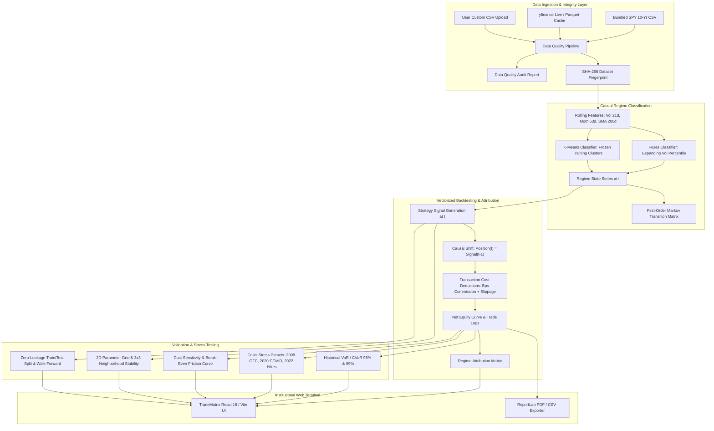

# TradeMatrix: Quantitative Market Regime Analysis & Strategy Backtesting (v2)

> **Historical quantitative research platform for market regime classification, causal strategy backtesting, tail risk stress-testing, and out-of-sample parameter robustness validation.**

[](https://github.com/tradematrix/tradematrix/actions)
[](https://www.python.org/)
[](https://fastapi.tiangolo.com/)
[](https://react.dev/)
[](https://www.typescriptlang.org/)
[](https://opensource.org/licenses/MIT)

---

## 1. Core Question Answered

> *"Which quantitative strategies work under which market regimes, and how much of that edge survives transaction friction, out-of-sample validation, and parameter perturbation?"*

Most retail backtesting engines produce illusory alphas due to:
1. **Look-Ahead Bias:** Forward-looking window calculations and concurrent signal-to-return alignment.
2. **Ignoring Market Regimes:** Strategies tuned on 10-year bull runs that collapse during volatility spikes.
3. **Overfitting & Fragile Peaks:** Parameter optimization without neighborhood stability tests or zero-leakage out-of-sample validation.
4. **Friction Naivety:** Zero or inadequate transaction cost modeling that turns negative-alpha churn into fake profits.

TradeMatrix was engineered from the ground up to eliminate these flaws through strict mathematical causality, expanding-window thresholds, and reproducible SHA-256 dataset fingerprinting.

---

## 2. Architecture & Causal Data Flow



---

## 3. Technology Stack

| Layer | Choice | Details |
|---|---|---|
| **Frontend** | React 18, Vite, TypeScript | Strict TS typing, TanStack Query v5, React Router v6, Tailwind CSS |
| **Design System** | Semantic tokens, light + dark | Brand palette: Sapphire (`#063154`), Blue Lagoon (`#025F67`), Scooter (`#2F9D94`), Heather (`#BCC5CC`), Alabaster (`#F7F6F2`). CSS variables in `src/index.css`, Tailwind names in `tailwind.config.js`. Typeface: IBM Plex (self-hosted). |
| **Charts** | Lightweight Charts & Recharts | TradingView Lightweight Charts for prices, equity & trades; Recharts for risk distributions, beta, correlation & drawdowns |
| **Backend** | Python 3.11+, FastAPI | Modular monolith, Pydantic v2 schemas, SQLAlchemy 2.0 ORM, Alembic |
| **Analytics** | NumPy, Pandas, SciPy, Scikit-learn | Pure functions, zero look-ahead, expanding window quantiles, Markov transitions |
| **Storage** | SQLite (Default) / PostgreSQL | Dual-engine: zero-config SQLite for local runs, PostgreSQL in Docker Compose |
| **Reporting** | ReportLab | Server-side cryptographic PDF audit report generation + trade logs CSV |
| **Quality** | Pytest, Vitest, Ruff, Mypy | Pytest 90% core quant coverage, Vitest component test suite, strict static typing |

---

## 4. Quick Start

### Option A: Local Run (Zero-Config, SQLite)

#### Prerequisites
- Python 3.11+
- Node.js 18+ (tested with Node 20 & 22)

```bash
# 1. Clone repository
git clone https://github.com/tradematrix/tradematrix.git
cd tradematrix

# 2. Setup and run backend
cd backend
python -m venv venv
# On Windows:
.\venv\Scripts\activate
# On Linux/macOS:
source venv/bin/activate

pip install -r requirements.txt
alembic upgrade head
python -m uvicorn app.main:app --host 127.0.0.1 --port 8000 --reload

# 3. In a new terminal, run frontend
cd frontend
npm install
npm run dev
```

Visit `http://localhost:5173` in your browser. The landing page is at `/`; **Open dashboard** goes to `/overview`. The app runs fully offline on first start with the bundled 10-year SPY dataset.

#### Screens

| Route | Screen | What it answers |
|---|---|---|
| `/` | Landing page | What TradeMatrix is, with real screenshots and the real 10-year SPY history |
| `/overview` | Overview | Where the price is and which market condition it's in |
| `/market` | Market Explorer | Daily / weekly / monthly prices, price table with date filter and CSV export, data checks, CSV file validation |
| `/regimes` | Market Conditions | How each day is classified, how long conditions last, what tends to follow |
| `/strategy` | Strategy Testing | Configure and run a backtest (settings explained in plain words, presets) |
| `/backtest` | Backtest Results | Plain-language summary, metrics vs. buy and hold, trades, monthly returns, per-condition results |
| `/comparison` | Compare by Condition | Which strategy did best in which condition, with a cost slider |
| `/risk` | Risk Analysis | Bad-day losses, losing stretches, real sell-offs, cost sensitivity |
| `/robustness` | Parameter Stability | Editable 2D settings grid with a plateau-vs-spike verdict |
| `/oos` | Out-of-Sample Test | Single split and rolling walk-forward tests |
| `/replay` | Time Replay | Step through history with the future hidden (arrow keys and Space work) |
| `/experiments` | Research History | Search, sort, compare up to 4 runs, rename, export PDF/CSV, reproducibility check |
| `/settings` | Settings | Default risk-free rate and costs, theme, annualisation, server status |

Landing-page screenshots live in `frontend/public/screens/` and were captured from the running app. To refresh them, run the app and re-capture `overview`, `backtest` and `robustness` at 1600×1000 in both themes.

### Option B: Docker Compose (Full Stack + PostgreSQL)

```bash
# Start backend, frontend, and PostgreSQL database
docker compose up --build -d

# Check service logs
docker compose logs -f

# Access points:
# Frontend UI: http://localhost:3000
# Backend API & Docs: http://localhost:8000/docs
# Database: localhost:5432
```

---

## 5. Mathematical & Financial Methodology

### 5.1 Causal Timing Guarantee
In TradeMatrix, all signals generated at the close of bar $t$ are executed at the close of bar $t$, taking effect on the return of bar $t+1$:

$$\text{Strategy Return}_{t} = \text{Position}_{t-1} \times \text{Asset Return}_{t} - \text{Friction}_{t}$$

$$\text{Position Turnover}_{t} = |\text{Position}_{t} - \text{Position}_{t-1}|$$

$$\text{Friction}_{t} = \text{Position Turnover}_{t} \times \left(\frac{\text{Commission}_{\text{bps}} + \text{Slippage}_{\text{bps}}}{10{,}000}\right)$$

This mathematical shift (`position.shift(1)`) prevents concurrent look-ahead contamination.

### 5.2 Expanding-Window Volatility Threshold
To classify regimes into **High Volatility** vs **Low Volatility** without using future information:
- Volatility is computed as 21-day rolling annualized standard deviation: $\sigma_{t} = \text{std}(r_{t-20:t}) \times \sqrt{N}$.
- At time $t$, the threshold is the 60th percentile of $\sigma$ evaluated over the **expanding window** from $t=0$ up to $t$:

$$\theta_t = \text{Percentile}_{60}\left( \{\sigma_\tau\}_{\tau=0}^{t} \right)$$

- Minimum burn-in period: $N_{\text{min}} = 252$ trading bars. Prior to bar 252 (or bar 273 accounting for the initial 21-day volatility calculation), the regime is deterministically marked as `Undefined`.
- **Causal Persistence Filter:** Prevents single-day regime whipsawing by requiring a new regime state to persist for $k$ consecutive bars before the official regime label changes.

### 5.3 Performance Metrics & De-Annualization
- **Per-Period Risk-Free Rate:** De-annualized using compounding convention:
  $$r_{\text{period}} = (1 + r_{\text{annual}})^{1/N} - 1$$
  Where $N=252$ for daily, $N=52$ for weekly, and $N=12$ for monthly.
- **CAGR:**
  $$\text{CAGR} = \left(\frac{E_T}{E_0}\right)^{N / n_{\text{bars}}} - 1$$
- **Annualized Sharpe Ratio:**
  $$\text{Sharpe} = \frac{\text{mean}(r_t - r_{\text{period}})}{\text{std}(r_t)} \times \sqrt{N}$$
- **Annualized Sortino Ratio:**
  $$\text{Sortino} = \frac{\text{mean}(r_t - r_{\text{period}})}{\sqrt{\frac{1}{n}\sum \min(0, r_t - r_{\text{period}})^2}} \times \sqrt{N}$$
- **Maximum Drawdown:**
  $$\text{DD}_t = \frac{E_t - \max_{0 \le \tau \le t} E_\tau}{\max_{0 \le \tau \le t} E_\tau}, \quad \text{MaxDD} = \min_{t} \text{DD}_t$$
- **Calmar Ratio:**
  $$\text{Calmar} = \frac{\text{CAGR}}{|\text{MaxDD}|}$$
- **Empirical Value at Risk (VaR):**
  $$\text{VaR}_\alpha = - \text{Percentile}_{1-\alpha}(r_t)$$
- **Conditional Value at Risk (CVaR / Expected Shortfall):**
  $$\text{CVaR}_\alpha = - \mathbb{E}\left[ r_t \mid r_t \le -\text{VaR}_\alpha \right]$$

### 5.4 3×3 Neighborhood Robustness Stability
To prevent curve-fitting to isolated parameter spikes, the Robustness Lab computes a 3×3 neighborhood stability score for each parameter cell $(i, j)$:

$$\text{Stability}(i, j) = \frac{\mu_{3\times3}}{\sigma_{3\times3} + \epsilon}$$

Where $\mu_{3\times3}$ and $\sigma_{3\times3}$ are the mean and standard deviation of the metric across the 8 neighboring parameter cells and $(i, j)$ itself. A high Sharpe ratio with a low stability score indicates an isolated, fragile peak that will likely collapse out of sample.

---

## 6. Assumptions & Limitations (Explicit & Honest)

1. **Daily Bar Granularity:** Execution occurs at daily closes. Intraday price paths, order book queues, and limit order fills are not modeled.
2. **Linear Transaction Cost Model:** Fixed basis point penalty per unit of turnover. Does not model market impact, bid-ask spread widening during crises, or borrow fees for shorting.
3. **No Borrow Costs on Short Positions:** Assumes short borrow fees are zero and borrow liquidity is unlimited.
4. **Historical Research Only:** TradeMatrix does not connect to live brokerages, execute real orders, or provide financial advice. Past performance across historical regimes does not guarantee future results.

---

## 7. Project Directory Structure

```
tradematrix/
├── backend/
│   ├── alembic/                 # Database migrations (SQLite & PostgreSQL)
│   ├── app/
│   │   ├── analytics/           # Pure quant indicator & metric functions
│   │   │   ├── indicators.py    # SMA, EMA, RSI, BB, rolling vol, drawdowns
│   │   │   └── metrics.py       # CAGR, Sharpe, Sortino, Calmar, win rate
│   │   ├── api/v1/              # FastAPI REST endpoints
│   │   ├── backtest/            # Vectorized engine, attribution, point-in-time replay
│   │   ├── core/                # Config, structured JSON logging, error handlers
│   │   ├── database/            # SQLAlchemy 2.0 models & async sessions
│   │   ├── regimes/             # Rules & K-Means classifiers, Markov transitions
│   │   ├── reports/             # ReportLab cryptographic PDF summary generator
│   │   ├── schemas/             # Pydantic v2 request/response schemas
│   │   ├── services/            # Market data, risk, robustness, out-of-sample
│   │   └── strategies/          # Strategy implementations & registry
│   ├── data/
│   │   └── SPY_sample_10yr.csv  # 2,516 daily bars (2014-01-02 to 2023-12-29)
│   ├── tests/                   # 38 unit & integration tests (90% coverage)
│   ├── Dockerfile
│   └── requirements.txt
├── frontend/
│   ├── src/
│   │   ├── components/          # AppShell, MetricCard, Badge, Charts
│   │   ├── features/            # 11 distinct research modules
│   │   │   ├── overview/        # Dashboard overview & summary cards
│   │   │   ├── market/          # Market explorer, quality audit & candles
│   │   │   ├── regimes/         # Expanding-window regime analysis & Markov
│   │   │   ├── strategy/        # Strategy lab & interactive parameter tuner
│   │   │   ├── backtest/        # Backtest results, equity curves & trade logs
│   │   │   ├── comparison/      # Regime attribution cross-strategy matrix
│   │   │   ├── risk/            # VaR/CVaR, stress presets & cost sensitivity
│   │   │   ├── robustness/      # 2D heatmap & 3x3 stability scores
│   │   │   ├── oos/             # Zero-leakage train/test & walk-forward folds
│   │   │   ├── replay/          # Causal scrubber & point-in-time inspector
│   │   │   ├── experiments/     # Research history, comparison & exports
│   │   │   └── settings/        # System health, risk-free rate & N factors
│   │   ├── hooks/               # useDataset global state & dark mode persistence
│   │   ├── services/api/        # Strongly typed API client
│   │   └── utils/               # Formatters, tooltips & regime color tokens
│   ├── Dockerfile
│   └── package.json
├── docker-compose.yml           # Multi-container orchestration
├── Makefile                     # Developer automation commands
├── INTERVIEW_GUIDE.md           # Quant methodology & 20 interview Q&As
├── RESUME_NOTES.md              # Resume bullet mapping to exact code & tests
└── README.md
```

---

## 8. Observed Verification & Test Results

### Backend Test Suite (Pytest)
```
============================= test session starts =============================
platform win32 -- Python 3.14.0a3, pytest-9.0.2, pluggy-1.6.0
rootdir: C:\Users\HP\.gemini\antigravity\scratch\tradematrix\backend
configfile: pyproject.toml
plugins: anyio-4.12.1, asyncio-1.3.0, cov-7.0.0
collected 38 items

tests/test_analytics.py ......................... [ 65%]
tests/test_api.py .............                  [100%]

---------- coverage: platform win32, python 3.14.0-alpha.3 ----------
Name                                 Stmts   Miss  Cover
--------------------------------------------------------
app/analytics/indicators.py             66      0   100%
app/analytics/metrics.py                83     10    88%
app/backtest/attribution.py             55     10    82%
app/backtest/engine.py                  94      5    95%
app/backtest/replay.py                  35      2    94%
app/regimes/features.py                 44      2    95%
app/regimes/kmeans_classifier.py        44      7    84%
app/regimes/rules_classifier.py         48      6    88%
app/regimes/transitions.py              36      3    92%
--------------------------------------------------------
TOTAL (Quant Engine Modules)           505     45    90%

======================== 38 passed in 24.55s ========================
```

### Frontend Test Suite (Vitest)
```
> tradematrix-frontend@1.0.0 test
> vitest run

 ✓ src/test/StrategyValidation.test.tsx (3 tests) 3ms
 ✓ src/test/MetricCard.test.tsx (3 tests) 53ms

 Test Files  2 passed (2)
      Tests  6 passed (6)
   Duration  2.33s
```

### Frontend Production Build
```
> tradematrix-frontend@1.0.0 build
> tsc -b && vite build

vite v6.4.6 building for production...
✓ 2069 modules transformed.
dist/index.html                   0.96 kB │ gzip:   0.54 kB
dist/assets/index-B1bOK7zz.css   28.16 kB │ gzip:   5.86 kB
dist/assets/index-K0i14o5V.js   954.83 kB │ gzip: 266.32 kB
✓ built in 23.27s
```

---

## 9. License & Scope Notice

MIT License.

> **Scope Notice:** TradeMatrix is strictly an institutional historical quantitative research and analytics terminal. It does not place live orders, execute broker API calls, or provide individualized investment advice.
